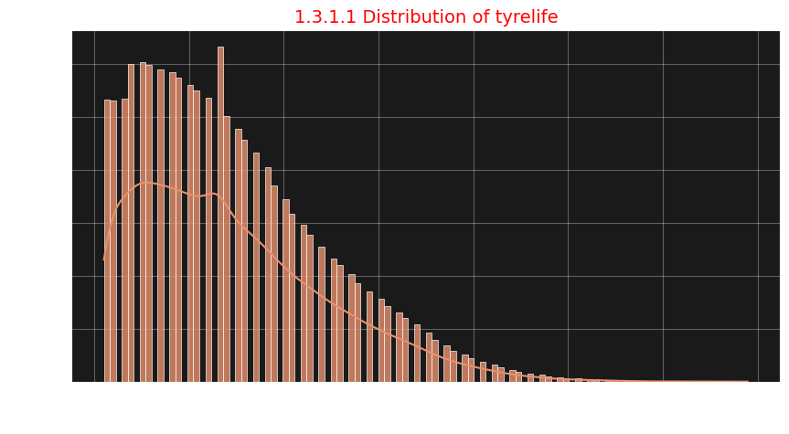
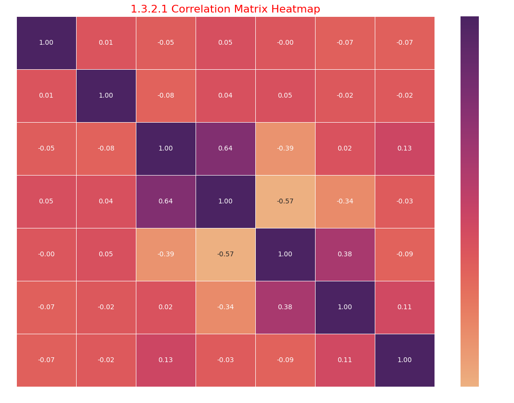

# F1 Tire Sim

Exploratory analysis and machine-learning models for Formula 1 tyre status, built in a Google Colab notebook on a public Kaggle lap dataset. The notebook ends with a small Gradio demo.

> Personal project (solo). Not affiliated with Formula 1, the FIA or any team; the team name used in the demo title is for illustration only.

## What the notebook does

`tire_sim.ipynb` runs top to bottom in these sections:

1. **Data preparation:** downloads the dataset with `kagglehub` and loads `f1_all.parquet` (69,230 laps × 30 columns, three seasons from 2021: race results, tyre compound, tyre life, stint and weather).
2. **Target:** creates `tire_status` with a fixed rule:
   - `optimal`: tyre life ≤ 15 laps on a fresh tyre
   - `marginal`: tyre life ≤ 40 laps
   - `critical`: otherwise
3. **Cleaning:** normalises column names, fixes types, handles missing values, standardises compound names and flags outliers (IQR).
4. **EDA:**
   - univariate: histograms, count plots, skewness and kurtosis
   - bivariate: correlation heatmap, scatter, box plots, bar plots
   - multivariate: 3D Plotly scatter, VIF, PCA
5. **Preprocessing:** one-hot encoding, standard scaling, IQR capping, SMOTE class balancing, 80/20 stratified split.
6. **Models:**
   - Fuzzy C-Means clustering (`scikit-fuzzy`)
   - Random Forest classifier
   - XGBoost classifier
   - Random Forest regressor for tyre life
7. **Demo:** a Gradio interface that takes lap and weather inputs and returns a status and a tyre-life figure.

## Data

The dataset is **not included** in this repository. See [`data/README.md`](data/README.md) for how to download it and where to check its terms of use.

## Exploratory data analysis

All numbers and figures below are the outputs saved in the notebook.

### Dataset at a glance

| Item | Value |
|---|---|
| Rows (laps) | 69,230 |
| Columns | 30 raw (37 after cleaning and outlier flags) |
| Seasons | 3 (from 2021) |
| Races / circuits | 64 races on 27 circuits |
| Drivers / constructors | 29 drivers, 10 constructors |
| Missing values | The data-info output shows 553 missing `TyreLife` and 75 missing `position_y` values. The cleaning cell's saved output reports 0 missing values and drops no rows, so these two outputs come from different runs. |

### Target balance (`tire_status`)

| Class | Share before SMOTE | Share after SMOTE |
|---|---|---|
| marginal | 51.25 % | 33.33 % |
| optimal | 46.34 % | 33.33 % |
| critical | 2.40 % | 33.33 % |

`critical` is rare, so SMOTE is used to balance the classes. After SMOTE the split gives 85,159 training rows and 21,290 test rows.

### Tyre compounds

| Compound | Laps |
|---|---|
| hard | 29,668 |
| medium | 24,965 |
| soft | 9,869 |
| intermediate | 3,886 |
| wet | 454 |
| none | 368 |
| unknown | 20 |

### Distributions

| Feature | Skewness | Kurtosis |
|---|---|---|
| tyrelife | 0.898 | 0.551 |
| stint | 0.895 | 0.896 |
| airtemp | -0.116 | 0.145 |
| tracktemp | 0.051 | -0.350 |
| humidity | -0.142 | -0.122 |
| pressure | -2.641 | 6.651 |
| windspeed | 1.449 | 1.939 |

- Tyre life and stint are right-skewed: most laps come early in a tyre's life, with a long tail of long stints.
- Air pressure is strongly left-skewed with heavy tails.
- The temperatures and humidity are close to symmetric.



*Distribution of `tyrelife` (laps on the current tyre; x axis = tyre life, y axis = number of laps).*

### Correlations



*Pearson correlations. Rows and columns, in order: tyrelife, stint, airtemp, tracktemp, humidity, pressure, windspeed.*

- **Air and track temperature:** they move together (0.64), and humidity falls as track temperature rises (-0.57).
- **Other weather pairs:** humidity and pressure 0.38, track temperature and pressure -0.34, air temperature and humidity -0.39.
- **Tyre life and weather:** tyre life is almost uncorrelated with the weather features (|r| ≤ 0.07) and with stint number (0.01).

### Multicollinearity (VIF)

| Feature | VIF |
|---|---|
| tyrelife | 3.13 |
| stint | 5.43 |
| airtemp | 51.52 |
| tracktemp | 34.39 |
| humidity | 17.19 |
| pressure | 76.20 |
| windspeed | 2.77 |

The VIF values were computed on the unscaled features without an intercept term. The very high values for pressure and the temperatures partly reflect that, not only true collinearity.

> **Note on the figures:** the notebook sets plot text to white, but the saved figures have a white background, so their axis labels and tick values are not visible. The captions above give the axes. Re-running the notebook with a dark figure background (`plt.rcParams['figure.facecolor']`) would show them.

## Setup

The notebook was developed in Google Colab (Python 3.12). To run it locally:

```bash
python -m venv .venv
# Windows: .venv\Scripts\activate    macOS/Linux: source .venv/bin/activate
pip install -r requirements.txt
pip install jupyter
jupyter notebook tire_sim.ipynb
```

Or upload `tire_sim.ipynb` to Google Colab and run it there. The notebook installs `scikit-fuzzy` and `gradio` itself with `!pip`.

## How to run

Run the cells in order. The first cell downloads the dataset (Kaggle access may be required, see `data/README.md`). The last cell starts the Gradio demo with a temporary public link (`share=True`).

## Results saved in the notebook

These numbers are the outputs saved in the notebook from its last run. Read them together with the limitations below.

| Task | Metric | Value |
|---|---|---|
| Fuzzy C-Means (3 clusters) | Silhouette / Davies-Bouldin / FPC | 0.1798 / 1.8247 / 0.3864 |
| Random Forest classifier | Accuracy / weighted F1 / ROC-AUC (OvR) | 0.9974 / 0.9974 / 0.9988 |
| XGBoost classifier | Accuracy | 0.9975 |
| Random Forest regressor (tyre life) | MAE / RMSE / R² | 2.82 / 4.48 / 0.7976 |

## Known limitations

- **The classification task is close to trivial.** `tire_status` is computed from `TyreLife` and `FreshTyre`, and both are also model inputs, so the near-perfect accuracy mostly reflects the rule rather than predictive skill.
- **Pre-split leakage:**
  - SMOTE, scaling and outlier capping are applied before the train/test split, so synthetic and transformed rows reach the test set.
  - In the regression, the features include `pca1`/`pca2`, which are computed from columns that include tyre life (the target).
- **The notebook does not run top to bottom as saved.** The clustering cell uses a variable `X_cluster` that no cell defines; its saved output comes from an earlier session.
- **The Gradio demo is untested in this repository.** It passes the classification feature columns to the regression model, and it labels the regression output as remaining laps although the model predicts tyre life (laps already run on the tyre).

## Status

Prototype / learning project. The limitations above are known and not yet addressed.
